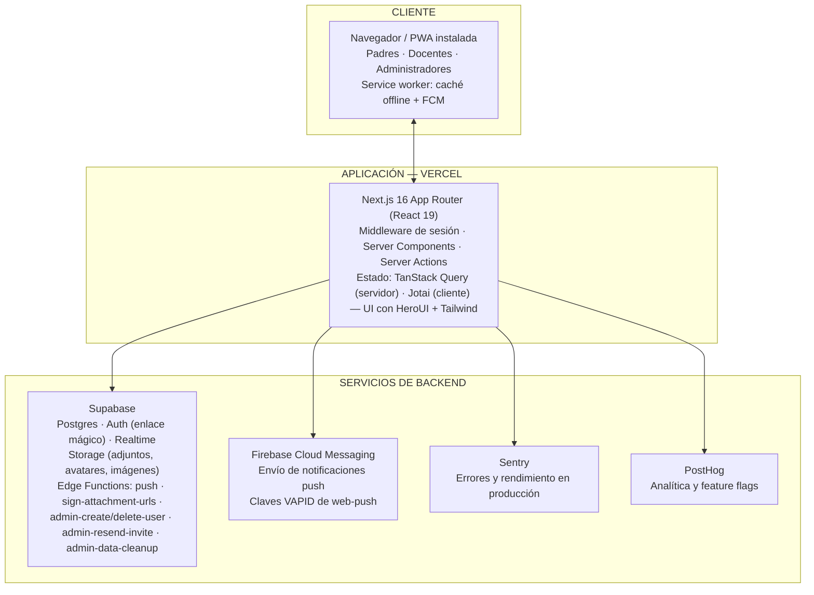

# Encanto App — Arquitectura y estado de entrega

**Informe para stakeholders · v1.4.0 · septiembre 2026**

Una aplicación web progresiva que conecta a familias y personal del Encanto Jardín Musical — reportes diarios, asistencia, mensajería y tareas en una sola app instalable. Este informe cubre qué está construido, sobre qué corre, y qué falta antes de un lanzamiento general.

| | |
|---|---|
| **Versión actual** | 1.4.0 · última rama publicada el 2026-09-10 |
| **Usuarios** | padres, docentes, administradores |
| **Hosting** | Vercel + Supabase |

## Índice

- [Resumen](#resumen)
- [Arquitectura](#arquitectura)
- [Servicios y proveedores](#servicios-y-proveedores)
- [Datos y seguridad](#datos-y-seguridad)
- [Línea de tiempo](#línea-de-tiempo)
- [Estado de avance](#estado-de-avance)
- [Próximos pasos](#próximos-pasos)

---

## Resumen

Un solo código, tres roles. Los padres siguen el día de su hijo; los docentes lo reportan; los administradores gestionan los grupos y el personal del jardín detrás de escena.

| | |
|---|---|
| **5** módulos centrales | feed, mensajes, reportes diarios, asistencia, tareas |
| **3** roles con permisos distintos | padre, docente, administrador |
| **1.0 → 1.4** | versiones publicadas desde octubre 2025 |
| **364** pruebas unitarias automatizadas (Vitest) | 96.8% cobertura en queries/hooks |
| **Instalable** | PWA con caché sin conexión e instalación en pantalla de inicio |
| **Tiempo real** | mensajes, feed y conteos de asistencia en vivo |

## Arquitectura

Una sola aplicación Next.js maneja tanto la interfaz que ven padres y personal como la lógica de servidor detrás de ella, apoyada en Supabase para datos e identidad y en Firebase para el envío de notificaciones push.

El middleware refresca la sesión de Supabase en cada solicitud; la app habla directamente con Supabase para datos/auth/storage/realtime, y con funciones edge dedicadas para operaciones privilegiadas (acciones de administrador, URLs firmadas de adjuntos, envío masivo de push). Sentry y PostHog operan en paralelo como observabilidad de apoyo, fuera del camino crítico de cada solicitud.

## Servicios y proveedores

Seis servicios externos, cada uno cubriendo una función. Sin infraestructura propia que operar — todo es administrado.

| Servicio | Función en el producto | Categoría |
|---|---|---|
| **Vercel** | Aloja y construye la app Next.js; gestiona previews por cada pull request y los despliegues a producción. | Hosting |
| **Supabase** | Base de datos Postgres, autenticación (enlace mágico), seguridad a nivel de fila, suscripciones en tiempo real, almacenamiento de archivos y funciones edge. | Backend |
| **Firebase (FCM)** | Entrega notificaciones push a dispositivos instalados, incluso con la app cerrada. | Notificaciones |
| **Sentry** | Captura errores y trazas de rendimiento tanto del navegador como del servidor. | Monitoreo |
| **PostHog** | Analítica de producto y feature flags — usado para lanzar nuevas acciones a roles específicos de forma gradual. | Analítica |
| **GitHub Actions + integración Git de Vercel** | CI en cada PR: lint, build, y desde esta semana la suite de pruebas unitarias y e2e (modo solo-reporte mientras se estabiliza). | CI/CD |

Retirado en la versión 1.4.0: las subidas directas a AWS S3 y las credenciales de AWS que las sostenían — los adjuntos ahora viven por completo en Supabase Storage, un proveedor menos que asegurar y cuyas claves rotar.

## Datos y seguridad

Cada tabla aplica seguridad a nivel de fila (RLS) asociada al usuario autenticado — es la propia base de datos la que rechaza una consulta fuera del rol de alguien, no solo la interfaz.

**Personas y matrícula**
- `profiles` → `auth.users`
- `children`
- `child_guardians`
- `groups` · `group_teachers`

**Actividad diaria**
- `messages`
- `daily_reports`
- `attendance`
- `tasks`

**Buckets de almacenamiento** (todos privados)
- `message-attachments`
- `children_avatars`
- `group_images`
- `teacher_avatars`

**Notificaciones**
- `device_push_tokens`
- `subscriptions`

El acceso se resuelve a través de una sola función de base de datos, `get_user_groups(user_id, user_role)` — el rol de un padre solo alcanza los grupos de sus propios hijos, el de un docente solo los grupos que tiene asignados. Las migraciones del 2026-09-09 reforzaron aún más esa capa: índices de cobertura sobre llaves foráneas, una reescritura de políticas RLS señaladas por reevaluarse en cada fila, consolidación de políticas permisivas redundantes, y revocación del permiso de ejecución sobre funciones security-definer a roles que no lo necesitaban — todos hallazgos del asesor de seguridad de Supabase resueltos antes de este informe. El cambio quedó archivado (`openspec/changes/archive/2026-09-10-fix-supabase-advisories/`) y su especificación (`database-hardening`, 5 requisitos) ya está sincronizada en `openspec/specs/database-hardening/spec.md`. Tres acciones adicionales (solo configurables desde el panel de Supabase, no vía migración) siguen pendientes del operador — ver `operator-actions.md` dentro del cambio archivado.

## Línea de tiempo

**Sin versión** · 2026-09-10
Se agregó infraestructura de pruebas automatizadas: Vitest para pruebas unitarias (364 pruebas, 96.8% de cobertura en `src/queries/` y `src/hooks/`, con un umbral del 80% exigido en CI) y Playwright para e2e (flujos críticos de auth, padres, docentes y administradores, con fixtures y sesiones de prueba aisladas de producción). Verificado contra una instancia local real de Supabase: dos huecos encontrados durante la verificación — la limpieza de fixtures entre corridas y un selector inestable en `teacher.spec.ts` — quedaron corregidos y reverificados en verde (11/11) en corridas consecutivas, y confirmados en verde también en CI (job de unit tests y de e2e, corrida manual sobre `main`). Con la suite estable en varias corridas de PR y una corrida manual, se quitó `continue-on-error` de ambos jobs en `ci.yml`: CI ahora bloquea la integración a `main` si una prueba falla.

**1.4.0** · 2026-09-09
Los adjuntos migraron de AWS S3 a Supabase Storage por completo — las subidas van directo desde el cliente, y las descargas están protegidas por URLs firmadas restringidas a los participantes de la conversación. Se agregó una limpieza de adjuntos huérfanos para administradores, con un paso de vista previa y un resguardo de un año de antigüedad antes de eliminar cualquier cosa.

**1.3.0** · 2026-08-20
Barra lateral colapsable para pantallas de escritorio; herramientas de administrador para limpiar datos de entidades; mejoras a reportes diarios (imagen de portada, descarga en PDF, nombre del niño en la lista de personal).

**1.2.0** · 2026-07-09
Lanzamiento de reportes diarios — el personal publica actualizaciones grupales o de un solo niño con fotos; los padres las ven en el feed con un filtro dedicado y reciben notificación al llegar.

**1.1.0** · 2026-07-07
El salto más grande: panel de administrador para niños/grupos/docentes/padres, registro de entrada y salida de asistencia del personal, tareas grupales, adjuntos en mensajes y notificaciones push multi-dispositivo — buena parte de lo que sostiene la app de hoy. También: migración a pnpm, actualización a Next.js 16 y React 19.2.

**1.0.0** · 2025-10-03
Primera versión: mensajería directa, inicio de sesión sin contraseña por enlace mágico, y feature flagging con PostHog para lanzamientos escalonados.

## Estado de avance

Una lectura directa de qué está sólido, qué necesita una decisión, y qué falta genuinamente antes de un lanzamiento más amplio.

| Estado | Punto | Detalle |
|---|---|---|
| ✅ Listo | La superficie central del producto está completa | Mensajería, feed, reportes diarios, asistencia y tareas — todo publicado y en uso activo por los tres roles. |
| ✅ Listo | La postura de seguridad acaba de mejorar | Cobertura de RLS en todas las tablas, más las correcciones del 2026-09-09 (índices, reescritura de políticas, permisos de funciones definer). |
| ✅ Listo | Ya existe una suite de pruebas automatizadas | Vitest (364 pruebas unitarias, 96.8% de cobertura en queries/hooks) y Playwright (e2e por rol) corren en CI en cada PR. |
| ✅ Corregido | La suite e2e ya se verificó contra Supabase local | Los 11 specs de Playwright corrieron y pasaron (11/11) contra una instancia local real, en corridas consecutivas. |
| ✅ Corregido | La limpieza de fixtures de e2e ya quedó corregida | `teardownFixtures()` no borraba filas en `messages`, `daily_reports`, `tasks` ni `attendance` antes de eliminar los usuarios de prueba (esas tablas usan `ON DELETE RESTRICT`), y el error de `deleteUser` se ignoraba. Corregido y verificado con corridas consecutivas en verde. |
| ✅ Corregido | Flake de selector en `teacher.spec.ts` corregido | `getByLabel('Grupo')` coincidía con dos elementos (el `<select>` nativo oculto de HeroUI y su botón visible), causando una falla intermitente. Se acotó a `getByRole('button', {name: /Grupo/})`. |
| ✅ Listo | CI ahora bloquea sobre pruebas fallidas | Con varias corridas consecutivas en verde (cuatro corridas de PR más una corrida manual que incluyó el fix de fixtures), se quitó `continue-on-error` de ambos jobs en `ci.yml` — un PR con una prueba rota ya no puede integrarse a `main`. |
| ⚠️ Necesita acción | Quedan 2 de 3 acciones del asesor de Supabase pendientes | El asesor de seguridad en vivo ya no marca el vencimiento largo de OTP (resuelto), pero **protección contra contraseñas filtradas** y **actualización de Postgres** (`supabase-postgres-15.8.1.114`) siguen abiertas — ambas solo configurables desde el panel de Supabase, no vía migración. |
| ℹ️ Decisión de alcance | Producto en un solo idioma, por diseño | Todos los textos son en español vía next-intl. No es una brecha a resolver: el alcance del proyecto es un único cliente hispanohablante, así que no está planeado dar soporte a otros idiomas. |
| ℹ️ Decisión de alcance | Un solo cliente, por diseño | Los grupos y roles asumen un único jardín (Encanto Jardín Musical) porque este trabajo se hizo para un solo cliente — no está planeado dar soporte multi-tenant a otros jardines. |

## Próximos pasos

**01 · Cerrar las 2 acciones restantes del asesor de Supabase**
De las tres acciones de panel documentadas como pendientes del operador en el cambio archivado `openspec/changes/archive/2026-09-10-fix-supabase-advisories/operator-actions.md`, una ya se resolvió (vencimiento de OTP). Quedan dos, solo configurables desde el dashboard de Supabase: activar protección contra contraseñas filtradas (HaveIBeenPwned) y actualizar la versión de Postgres.

---

*Encanto App · informe interno de entrega · v1.4.0 · main · 2026-09-10*
